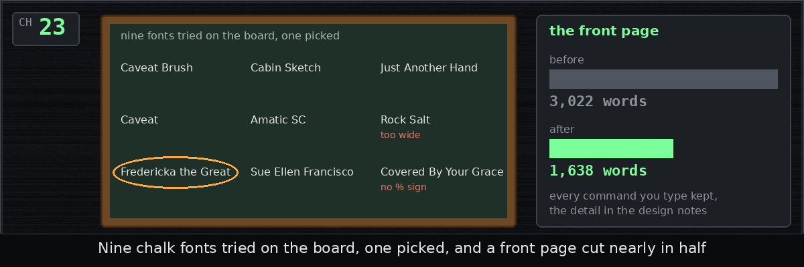

# skindeep

Skindeep Knickknacks, Instruments, and Needles, Delivering Essentially Equivalent Performance.

[**Read the dev diary**](https://b-g-goodell.github.io/skindeep/): one
entry per chapter, in plain words, with a picture. The latest:

[Chapter 23: Chalk, and a shorter front page](docs/diary/23-chalk-and-readme.md)

Winamp-style skins for Claude Code and Codex on Linux. Your agent runs
as always in a real terminal, while the skin around it shows gauges,
needles and lamps that move with what the agent is doing, and a second
window draws a visualizer from it. Its commands are `claude-skins`,
`codex-skins` and `skinned`.

The gauges show how full the context is, how near auto-compact is, the
session's cost, your usage limits, and the tools and helpers the agent
runs. The app never types into the terminal, changes its output, calls
a model or edits your settings, and a strip at the top that no skin can
cover names the running command and its folder.

## Install

You need Linux with a desktop, `git`, `claude` or `codex` on PATH,
Node.js 22.12 or newer, `python3`, `make`, `g++`, fontconfig and the
DejaVu fonts. To draw the visualizer from your speakers, add `parec`
(`pulseaudio-utils`) or `pw-record` (`pipewire-bin`).

    git clone https://github.com/b-g-goodell/skindeep.git
    cd skindeep
    ./install.sh

If something is missing, the script says how to get it and stops.
Otherwise it downloads Electron (about 120 MB) and puts `claude-skins`,
`codex-skins` and `skinned` in `~/.local/bin`, or in `BINDIR` if you
set it. Where Chromium's sandbox cannot start yet, it asks for `sudo`
once to make it start, or, with no terminal to ask on, prints the two
commands to run as root. Run it again after each `git pull`, and `./uninstall.sh`
removes the commands, as [decision 0018](docs/decisions/0018-install.md)
explains. Or tell your agent:

> Install skindeep from https://github.com/b-g-goodell/skindeep
> by its README, running ./install.sh until it succeeds.

## Use

Type `claude-skins` for `claude` and `codex-skins` for `codex`: every
argument passes through, as in `claude-skins --resume`, and the command
exits with the CLI's own status. `SKINNED_SKIN=phosphor claude-skins`
picks a skin, and a profile set by `CLAUDE_CONFIG_DIR` or `CODEX_HOME`
works as usual, with its name in the window title.

The three bars at the top left open four menus in a bar: **File** for
the tabs, Settings and Housekeeping, **Agents** for Agent sessions and
Sessions dashboard, which watch every Claude Code and Codex session on
your machine, **Skins** for Open skin... and the skins, and
**Visualization** for its window, mode and input and Mute skin sounds.
A click on a title, or Left and Right, moves between them, and Escape
closes them.

**New tab...** opens a tab on another agent, profile or folder, with
its command line shown, and, where `select-agent-config` is installed,
inside one of its snapshots of the agent configuration, a fresh install
or a fork of the live one, as [decision
0037](docs/decisions/0037-snapshot-tabs.md) says.

Ctrl+Shift+T opens a tab, Ctrl+Shift+W closes one and
Ctrl+Tab moves between them, and you can drag a tab out to give it its
own window, or right click it to rename it. Ctrl+Shift+C copies,
Ctrl+Shift+V pastes and Ctrl+click opens a link, while a bare Ctrl+V
goes to the CLI. The [decisions](docs/decisions/) say how each part
behaves.

`skinned` runs any command in a skin, as in `skinned -- htop`:

    skinned [--skin NAME|PATH] [--statusline=always|chain-only] [--no-viz] [--mute] -- COMMAND [ARGS...]

Any command gets CPU, memory and output meters, `claude` and `codex`
get the rest, and each launch writes a log to
`~/.local/state/claude-skins/`.

## Where the meters come from

The meters, listed in [decision 0011](docs/decisions/0011-metric-vocabulary.md),
come from Claude Code's statusline, hooks and transcript, from Codex's
session file, and for any other command from `/proc` and the terminal.
For Claude Code, the app adds `--settings <file>` to the command line,
and your own statusline still runs. Claude Code hides its shortcuts
hint under a statusline, so to keep the hint, run
`skinned --statusline=chain-only -- claude`, which blanks cost, limits
and the cache ratio.

## Visualization

The visualizer turns each tab's session into a made-up sound, so output
thumps, tool calls ring and the picture calms when the agent idles.
With two tabs or more, each tab draws its own small trace of it in the
tab strip: a moving band while its agent works, a flat green line once
it is done.
**Visualization input** in the Visualization menu switches it to what
your speakers play, and it never records a microphone. Each pane has a
drop-down at its top left to pick its mode, and space steps through
them all, six of which [docs/viz-modes.png](docs/viz-modes.png) shows.
A click goes to the mode: in Quantum a drag throws a packet, a press
held still paints a barrier and a click measures, a click in Go plays
a stone, and a click on Carbon's level diagram excites the
atom to that level.

## Skins

| deck | phosphor |
| --- | --- |
|  |  |
| **library** | **coffee** |
|  |  |

Drag the edge between the terminal and a panel beside it to give the
panel more room or less. The skin keeps the size, and **Reset panel
sizes** in the File menu's Settings brings back its own.

Settings also holds the size of every text: the terminal's font size,
and from 70 to 150 percent the skin's text, the window's own (strips,
tabs, menus, dialog, dashboard) and the visualization's. A larger text
grows as far as the skin's art leaves it room.

A plain `claude-skins` opens the skin you used last, and you can mute
its sounds from the Visualization menu or start muted with
`skinned --mute` or `SKINNED_MUTE=1`. To make your own, read
[docs/SKINS.md](docs/SKINS.md), put it under `skins/` or pass its path,
and try it on the fake agent in the checkout, which moves every meter
without spending tokens:

    skinned --skin ~/my-skin -- scripts/fake/claude

## Known limits

- Chromium's sandbox confines every page the app renders: the terminal
  draws whatever the agent prints, web pages and files it read among
  them, and a skin's images, fonts and sounds go through Chromium's
  decoders, so a shared skin is untrusted input. The sandbox needs root
  once: `install.sh` installs an AppArmor profile for the checkout's
  Electron where AppArmor restricts user namespaces, as on Ubuntu 23.10
  and later, else makes `chrome-sandbox` setuid root. Until then
  `skinned` refuses to start. `skinned --unsafe-no-sandbox` or
  `SKINNED_UNSAFE_NO_SANDBOX=1` runs without the sandbox, and a bug in
  any page then runs with all your rights
  ([decision 0001](docs/decisions/0001-stack.md)).
- The app keeps its runtime files, among them the scripts its windows
  load and the links its hooks report through, in
  `$XDG_RUNTIME_DIR/claude-skins`, else in
  `~/.local/state/claude-skins-run`. It refuses to start when another
  user could have made that folder or could rename it away, but it
  trusts a folder above it that your primary group may write, since on
  most Linux systems that group is yours alone. Where several people
  share one primary group, any of them who can write such a folder
  could swap those files and run commands as you. On such a machine,
  remove group write from every folder above the runtime folder, or
  make sure `XDG_RUNTIME_DIR` is set, as a desktop login sets it.
- Two Codex sessions started in one folder within 2 s may swap meters
  ([decision 0013](docs/decisions/0013-codex-channel.md)).
- Claude Code's `/context` breakdown has no channel, so the context
  gauge shows cached and uncached tokens instead.

## Development

`npm test` runs the tests, `scripts/checks/` holds live checks that run
under Xvfb, and `npm run checks -- OUT` runs every one of them that
needs no real agent, `scripts/fuzz/` holds a fuzz harness, and `scripts/shots.js`
retakes this page's screenshots with two real prompts. The live checks
start Electron with Chromium's sandbox, so they need `install.sh`'s
root step, or `SKINNED_UNSAFE_NO_SANDBOX=1` to run without it. The design is in
[docs/DESIGN.md](docs/DESIGN.md), how it was built, chapter by chapter,
in the [dev diary](docs/diary/README.md), and [decision 0019](docs/decisions/0019-tests.md)
says what the tests cover.

## License

The code is under the MIT license, in [LICENSE](LICENSE), and the fonts,
images and libraries keep their own, listed in `ASSETS.json`.

skindeep is an independent project, not affiliated with Anthropic,
OpenAI or the makers of Winamp.
