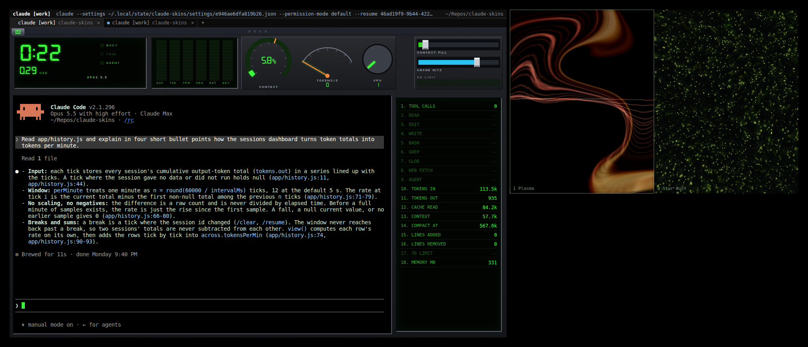
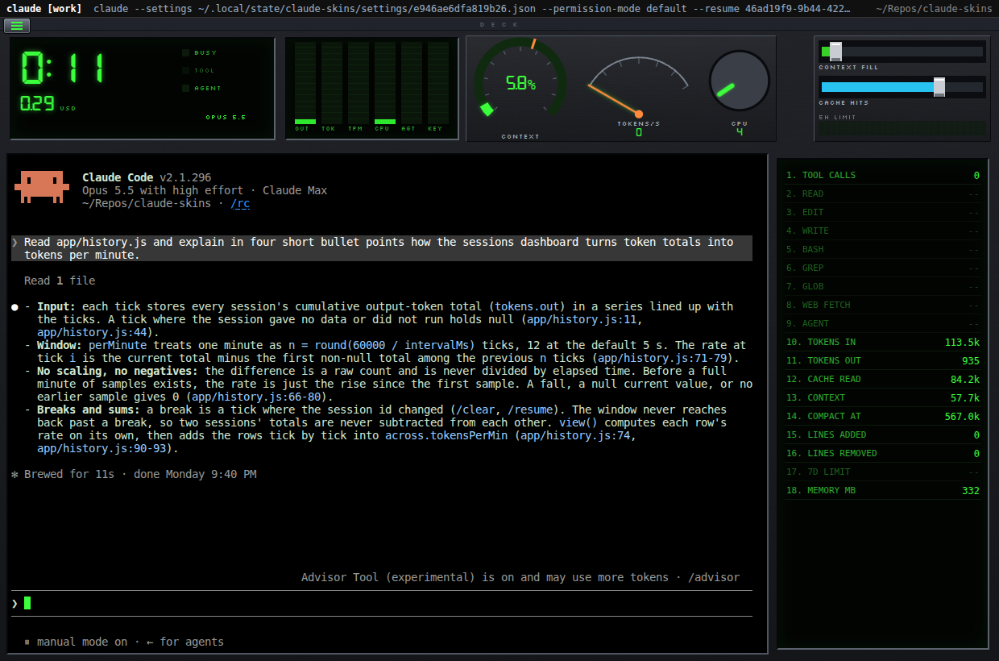
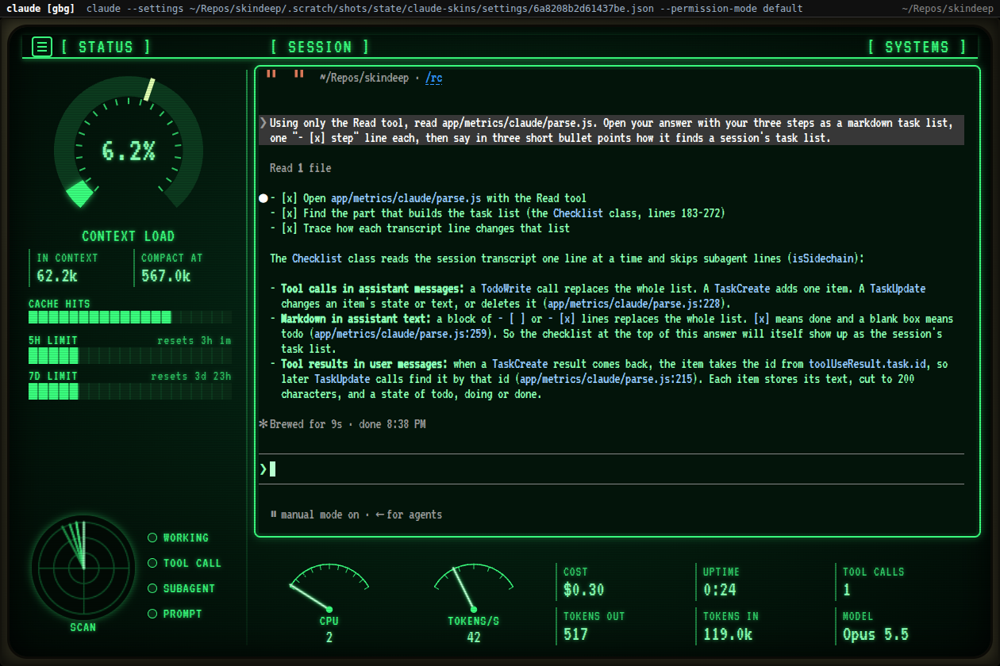
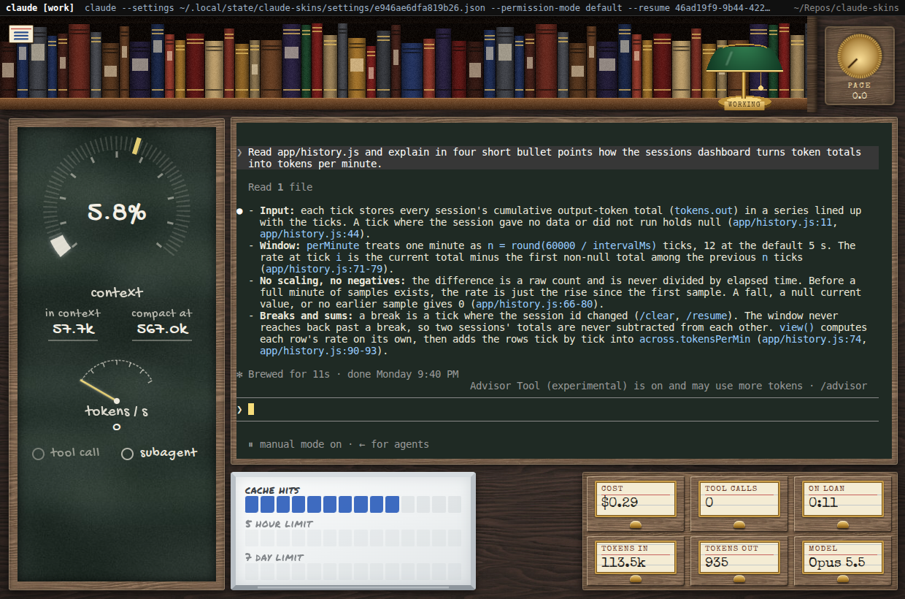
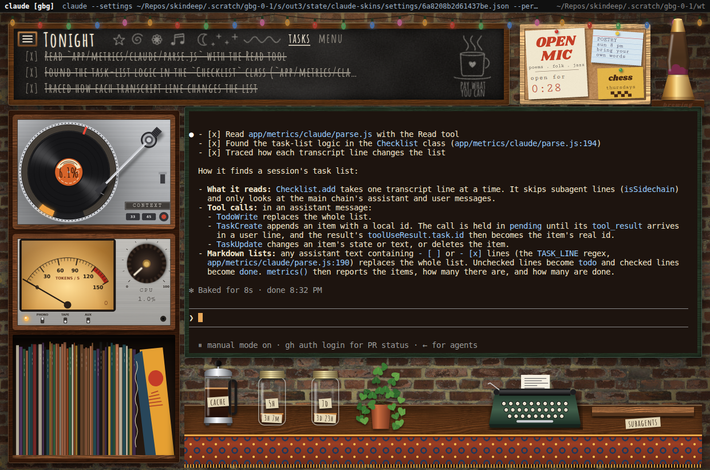

# skindeep

Skindeep Knickknacks, Instruments, and Needles, Delivering Essentially Equivalent Performance.

Winamp-style skins for Claude Code and Codex on Linux. Your agent runs
as it always does, in a real terminal. Around it, the skin shows gauges,
needles and lamps that move with what the agent is doing, and a second
window draws a visualizer from it. Its commands are `claude-skins`,
`codex-skins` and `skinned`.

## What it is for

A coding agent's terminal tells you little at a glance. The skin shows
how full the context is, how close auto-compact is, what the session
cost, how much of your usage limits is left and when they reset, which
tools the agent calls, and how many helpers it runs. It is also fun to
watch.

The app stays out of the agent's way:

- The terminal is the real CLI, byte for byte. The app never types into
  it, never changes its output, and never calls a model itself.
- It has the access your Claude Code session has, and no more.
- A strip at the top, which no skin can cover, names the command that
  runs and its folder.
- The meters come from channels the CLIs offer. Your settings files are
  never edited.
- A skin is data: a manifest, images, fonts and CSS. It cannot run code.

## Requirements

- Linux with a desktop.
- `git`, and `claude` or `codex` on PATH.
- Node.js 22.12 or newer, for the install only.
- `python3`, `make` and `g++`, to build the terminal layer. The app
  also needs `python3` when it runs.
- fontconfig and the DejaVu fonts. Most desktops have them.
- Optional: `parec` (Debian: `pulseaudio-utils`) or `pw-record`
  (`pipewire-bin`), to draw the visualizer from your speakers.

The system packages, by distribution:

| Distribution | Command |
| --- | --- |
| Debian, Ubuntu | `sudo apt-get install -y build-essential python3 git fontconfig fonts-dejavu-core` |
| Fedora, RHEL | `sudo dnf install -y gcc-c++ make python3 git fontconfig dejavu-sans-mono-fonts dejavu-sans-fonts` |
| Arch | `sudo pacman -S --needed base-devel python git fontconfig ttf-dejavu` |
| openSUSE | `sudo zypper install -y gcc-c++ make python3 git fontconfig dejavu-fonts` |

If your Node.js is older than 22.12, nvm installs a newer one in your
home directory, with no root (from <https://nodejs.org/en/download>):

    curl -o- https://raw.githubusercontent.com/nvm-sh/nvm/v0.40.8/install.sh | bash
    . "$HOME/.nvm/nvm.sh"
    nvm install 22

Run `./install.sh` in that same shell.

## Install

    git clone https://github.com/b-g-goodell/skindeep.git
    cd skindeep
    ./install.sh

The script checks everything first. If something is missing, it says
what and how to get it, then stops. Otherwise it installs the
dependencies, downloads Electron once (about 120 MB), and puts three
commands in `~/.local/bin`: `claude-skins`, `codex-skins` and `skinned`.
Set `BINDIR` to put them elsewhere.

Run `./install.sh` again after a `git pull`. `./uninstall.sh` removes
the three commands. [Decision 0018](docs/decisions/0018-install.md) has
the details.

### Installing with an agent

Tell your agent:

> Install skindeep from https://github.com/b-g-goodell/skindeep
> following its README: clone it, run ./install.sh, install whatever
> prerequisites it reports, and run ./install.sh again until it
> succeeds.

Root is needed only for missing system packages. If your agent cannot
use sudo, run that one command yourself.

## Use

Type `claude-skins` where you would type `claude`, and `codex-skins`
where you would type `codex`. Every argument goes to the CLI, and the
command exits with the CLI's own status. Subcommands such as
`claude-skins mcp list` or `claude-skins attach ID` run as they would
without the app.

    claude-skins
    claude-skins --resume
    codex-skins
    SKINNED_SKIN=phosphor claude-skins

Another profile works as it does without the app, and the window title
names it: `CLAUDE_CONFIG_DIR=~/.claude-work claude-skins` runs as
`claude [work] in claude-skins`. `CODEX_HOME` does the same for Codex.

In the window:

- The three bars near the top left open the menu: tabs, skins, the
  visualizer, sounds, settings and housekeeping.
- **Tabs.** Ctrl+Shift+T opens a tab running the same command.
  **New tab...**, or the + on the tab strip, lets you pick the agent,
  the profile and the folder. You can reopen a closed tab, or fork the
  current one with Duplicate. Ctrl+Shift+W closes a tab, and Ctrl+Tab
  and Ctrl+Shift+Tab move between them. Drag a tab to reorder it, or drag it out of the
  window to give it a window of its own.
- **Agent sessions** in the menu lists every Claude Code and Codex
  session running on your machine. Click one to watch its meters in a
  read-only tab. **Sessions dashboard** graphs them all, with each
  project's open issues.
- **Settings** sets the terminal's font size, for every skin.
- Copy with Ctrl+Shift+C, paste with Ctrl+Shift+V or Shift+Insert, and
  open a link with Ctrl+click. A bare Ctrl+V reaches the CLI.
- The app ends when its last tab does, with that tab's exit status.

The decisions in [docs/decisions](docs/decisions/) say exactly how each
part behaves: tabs in [0023](docs/decisions/0023-tabs.md), New tab... in
[0025](docs/decisions/0025-new-tab-chooser.md), Reopen and Duplicate in
[0026](docs/decisions/0026-reopen-duplicate.md), Agent sessions in
[0027](docs/decisions/0027-agent-sessions.md), the dashboard in
[0028](docs/decisions/0028-sessions-dashboard.md), exit statuses in
[0003](docs/decisions/0003-launcher.md).

`skinned` runs any command in a skin, with every option:

    skinned [--skin NAME|PATH] [--statusline=always|chain-only] [--no-viz] [--mute] -- COMMAND [ARGS...]
    skinned --skin phosphor -- htop

Any command gets CPU, memory and output meters. `claude` and `codex`
get the rest. Each launch writes a log to `~/.local/state/claude-skins/`.

## Where the meters come from

| CLI | Channel | Meters |
| --- | --- | --- |
| Claude Code | statusline JSON | context, cost, usage limits and their resets, cache hit ratio, model |
| Claude Code | command hooks | tool calls, prompts, turns, helpers, compaction |
| Claude Code | the session transcript | tokens in and out, cache reads and writes |
| Codex | the session rollout file | context, tokens, cache, limits, model, turns, helpers |
| any command | `/proc` and the terminal | CPU, memory, output rate, idle time, session clock |

For Claude Code the app adds `--settings <file>` to the command line, to
register its hooks and a statusline relay. Your own statusline still
runs and still shows. The strip shows the added option.

Claude Code hides its `? for shortcuts` hint whenever a statusline is
set. To keep the hint, run `skinned --statusline=chain-only -- claude`.
Cost, limits and the cache ratio then read nothing.

[Decision 0010](docs/decisions/0010-statusline-relay-and-chain.md) has
the relay, [0011](docs/decisions/0011-metric-vocabulary.md) every meter
and which of `/usage`'s figures reach the app, and
[0030](docs/decisions/0030-background-sessions.md) sessions sent to the
background.

## Visualization

The visualizer has no music to listen to. It builds a made-up sound
from each tab's session: output thumps, each tool call rings at its own
pitch, a prompt chirps, and the picture calms when the agent idles.
**Visualization input** in the menu can switch it to what your speakers
play instead. It never records a microphone, and it writes nothing.

Each tab gets a pane of its own. Click a pane, or press space, to step
through its fifteen modes, or pick one from the menu:

- **Drift**, **Rings**, **Plasma**, **Star dust** and **Whirlpool**:
  swirling pictures in the style of MilkDrop.
- **Scope**, **Spectrum analyzer** and **Fire analyzer**: Winamp's bars,
  redrawn.
- **Superscope** and **Dot plane**: two effects of Winamp's Advanced
  Visualization Studio.
- **Fern**: Barnsley's fern, growing point by point.
- **Go**: a game of Go, a stone for each event.
- **Zoom out**: an atom that turns out to be part of a snowflake, and so
  on out to a galaxy, and back to the atom.
- **Gravity**: planets, comets and stars pulling on each other.
- **Quantum**: wave packets through slits, by Schroedinger's equation.

[docs/viz-modes.png](docs/viz-modes.png) shows the last five at work.
[Decision 0015](docs/decisions/0015-visualization.md) has how each mode
reads the session.

## Skins

Four skins come with the app:

- `deck`, a dark metal music-player face with green readouts.
- `phosphor`, a green phosphor console with a radar sweep.
- `library`, a reading room with a chalkboard, a whiteboard and a
  banker's lamp that lights while the agent works.
- `coffee`, a basement cafe with a turntable, a tube amp, a lava lamp
  and the quiet sounds of the room.

Each shot below is the same Claude Code session, resumed in that skin:

| deck | phosphor |
| --- | --- |
|  |  |
| **library** | **coffee** |
|  |  |

A plain `claude-skins` opens the skin you used last. A skin's sounds
play quietly while it is on. Mute them from the menu, or start muted
with `skinned --mute` or `SKINNED_MUTE=1`. A skin fits half your
screen: below its full width it is drawn smaller.

To make your own, read [docs/SKINS.md](docs/SKINS.md). Put it under
`skins/` to list it in the menu, or pass its path:
`SKINNED_SKIN=~/my-skin claude-skins`. A broken skin fails at launch and
names the file and the field. To try it without spending tokens, run it
on the fake agent in the checkout, which moves every meter:

    skinned --skin ~/my-skin -- scripts/fake/claude

## Known limits

- Linux only.
- Electron runs with `--no-sandbox`, since Ubuntu blocks what Chromium's
  sandbox needs. The app loads only local content, and skins carry no
  code.
- Two Codex sessions started in one folder within 2 s of each other may
  follow each other's meters ([decision 0013](docs/decisions/0013-codex-channel.md)).
- Claude Code's `/context` breakdown has no channel, so the context
  gauge shows cached and uncached tokens instead.

## Development

    npm test

`scripts/checks/` holds live checks that run under Xvfb, and
`scripts/fuzz/` a fuzz harness. The design is in
[docs/DESIGN.md](docs/DESIGN.md), how it was built, chapter by chapter,
in the [dev diary](docs/diary/README.md), and [decision 0019](docs/decisions/0019-tests.md)
says what the tests cover.

## License

MIT, see [LICENSE](LICENSE). Fonts, images and libraries keep their own
licenses, listed in `ASSETS.json`.

skindeep is an independent project, not affiliated with Anthropic,
OpenAI or the makers of Winamp.
