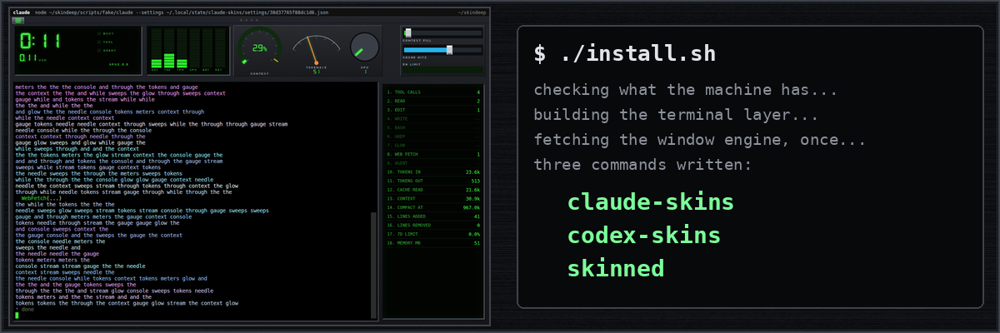

# Chapter 14: The window, at last

*Posted Wednesday, October 14, 2026, at 8:34 PM*

Everything from the last thirteen chapters comes together here.

At first, the only menu was a right click outside the terminal,
which few people would ever find.
So every skin now places a menu button,
and the app draws that button on top, where no skin can hide it.

The installer, a single file, first checks for everything it needs,
and if something is missing, it lists all of it at once,
with how to get it on your kind of Linux.
The first version stopped at the first missing piece,
so you had to run it again for every one.
It writes three plain commands, claude-skins, codex-skins and skinned,
each with a marker line,
so uninstalling removes exactly those three and never a file of yours.

A test install on a brand-new copy of Ubuntu without the DejaVu fonts
came out in some other font.
The first fix packed the fonts into the app, all 2.6 megabytes.
Then I asked why we didn't just list the fonts as something you need,
since most Linux desktops already have them,
so the packed copy came back out,
and the installer now checks that the fonts are installed.

Filed under: window, installer, fonts, menus
