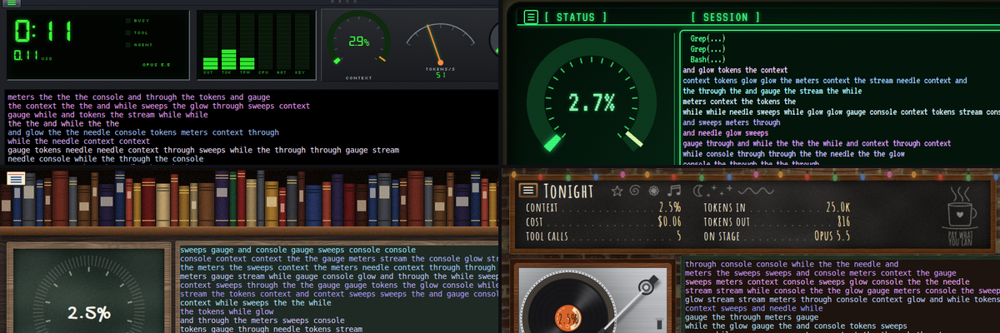

# Chapter 16: The front page

*Posted Wednesday, October 14, 2026, at 9:11 PM*

The last chapter is the page people see first.
It explains what skindeep is for, how to install it and how to use the window,
and it says where every meter's numbers come from.

The page's gallery shows a screenshot of every skin.
Each one shows the same earlier Claude Code conversation,
opened again in that skin without sending a new message,
so the pictures didn't use up any of my usage.

To test the page, a new user started on a brand-new, empty copy of Ubuntu
and followed the page step by step, from the first command to every skin.
That's how the font problem from chapter 14 turned up.

The known limits are on the page.
skindeep runs on Linux only.
If two Codex conversations start in the same folder
within two seconds of each other,
skindeep may follow the wrong log.

The project is called skindeep now,
but the commands keep their original names, claude-skins and codex-skins.

With this chapter the project reaches version 0.1.0, its first release,
with four skins, ten visualizer modes,
and several conversations in tabs of one window.

That's all sixteen chapters, and thanks for following along.

Filed under: release, screenshots, front page
