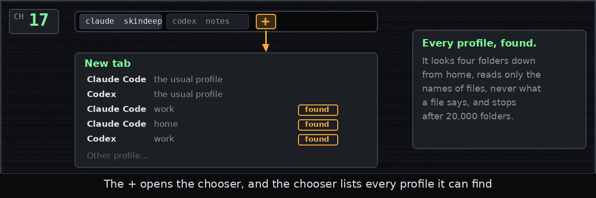

# Chapter 17: Every profile on the machine

*Posted Wednesday, October 14, 2026, at 9:33 PM*

Version 0.1.0 was out,
and these last seven chapters are what daily use turned up.

A profile is the hidden folder where Claude Code or Codex keeps one login
and its settings, and some people keep several.
The New tab... dialog only offered the usual profile,
the ones open in other tabs and the ones you had picked before,
so for any other you had to hunt through a file picker
for a hidden folder.

I had ruled out searching for profiles at first, but changed my mind,
and now each time the dialog opens, skindeep looks through your home folder,
at most four levels down,
and recognizes a profile by the names of its files.
It reads only those names, never what a file says,
never steps inside a profile, and gives up after 20,000 folders.
The profiles it finds come last in the list,
and Other profile... stays for any it misses.

The tab row's plus sign used to copy the current tab at once,
and I asked for it to open the New tab... dialog instead,
so you choose the profile and the folder,
while Ctrl+Shift+T still makes the quick copy.

Filed under: tabs, profiles, menus
