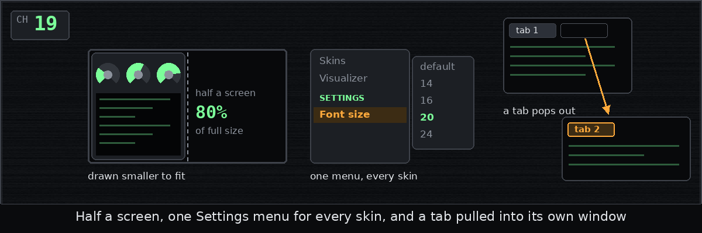

# Chapter 19: Half a screen, a Settings menu and a tab popped out

*Posted Wednesday, October 14, 2026, at 10:16 PM*

Snap a window to one half of a wide screen, and it should fill that half.
Every skin needed at least 1,100 pixels, more than half of a common 1,920,
so a snapped window ran past the middle or off the screen.
The skins couldn't simply get narrower, since their gauges would overlap,
so below its usual width, a skin is now drawn whole at a smaller size,
like a photograph shrunk to fit.
The terminal keeps its letter size and shows fewer columns,
never fewer than 40.

I also asked for one Settings section in the menu,
identical in every skin, so that no skin can add or hide a setting.
The first setting is the terminal's font size, from 8 to 32,
and a choice changes every tab at once
and stays after you switch skins or restart.

Finally, a tab dragged out of the window now pops out into a window of its own,
as it does in a web browser,
and the tab keeps everything it had already printed.
I had ruled this out early on, and this reverses it.
Both windows still share one skin, so choosing a skin in either changes both.

Filed under: windows, settings, tabs, fonts
