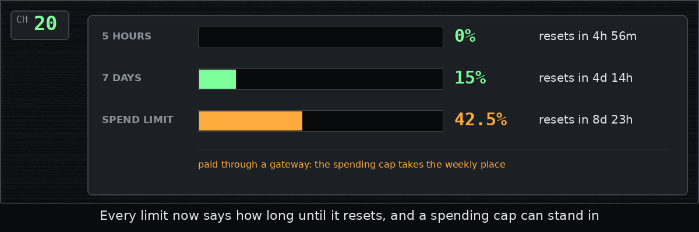

# Chapter 20: When the limits reset

*Posted Wednesday, October 14, 2026, at 10:37 PM*

Claude Code can show a usage report:
how much of your limits you've used,
for the current five hours and for the week,
and when each one starts over.
skindeep already showed how full the two limits were,
but not when they would reset.

Claude Code already hands skindeep the reset times,
along with the line it writes at the bottom of the screen.
skindeep now shows each one as the time left, such as 3h 12m or 4d 2h,
next to its meter in every skin.
skindeep never asks the internet for anything itself,
so the parts of the usage report that never reach it stay out.

Some sessions are paid through a gateway that a company sets up,
with a spending cap instead of the usual limits.
For them the weekly meter sat empty,
so now it shows the spending cap in its place, with its own reset time.

Then I checked everything on a real Claude Code conversation,
with one tiny message asking for a single word.
Every skin showed the five-hour limit resetting in 4h 56m,
and the weekly limit at 15 percent, resetting in 4d 14h.

Filed under: limits, meters, usage
