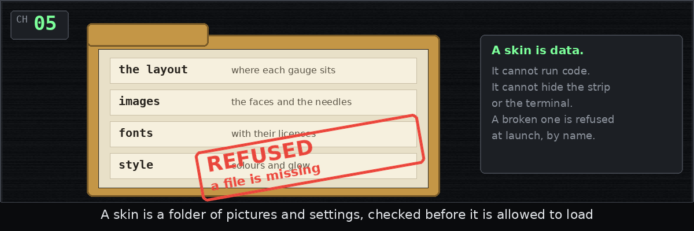
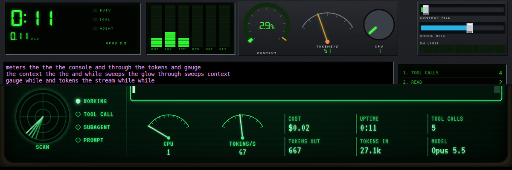
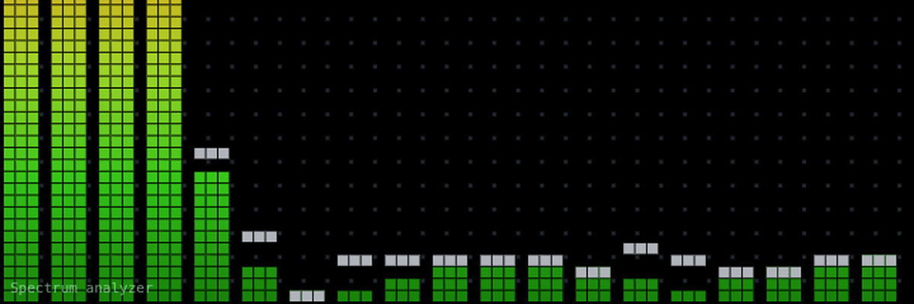
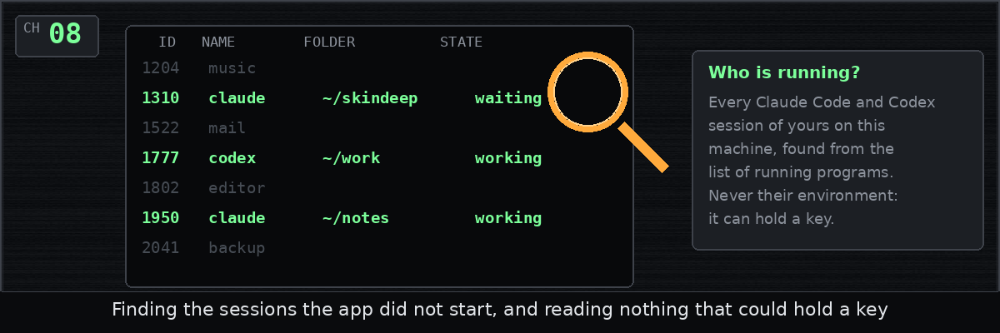
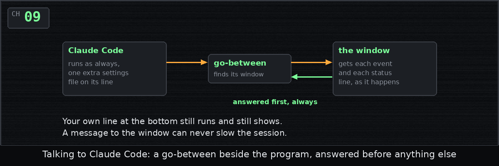
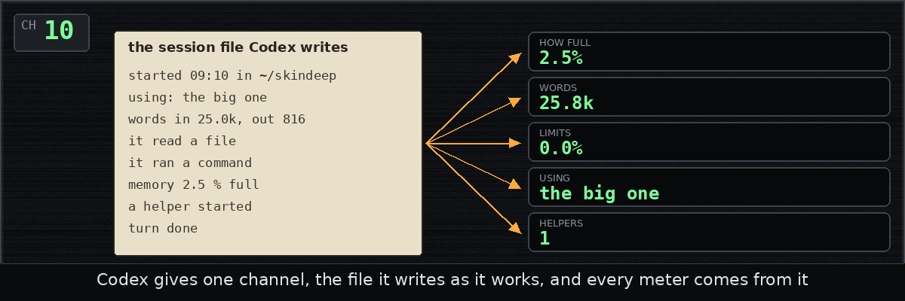
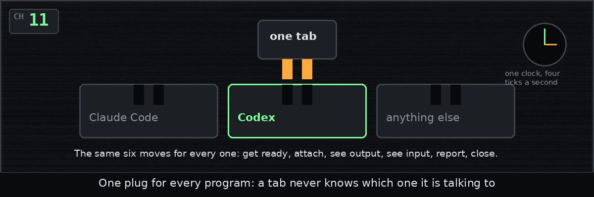
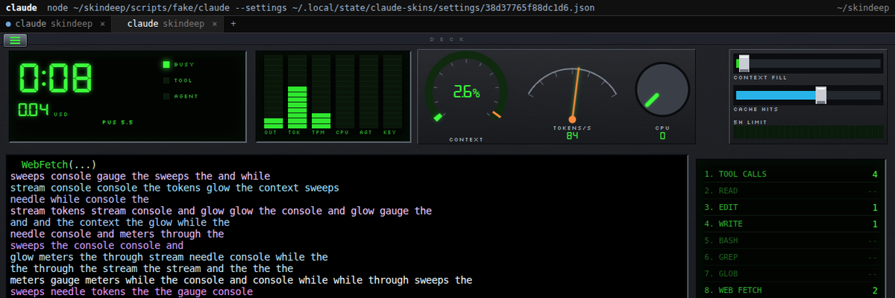
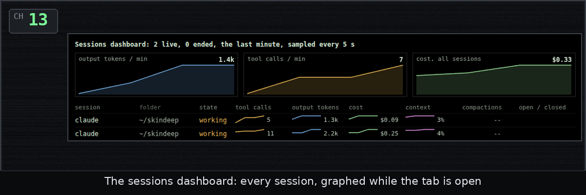
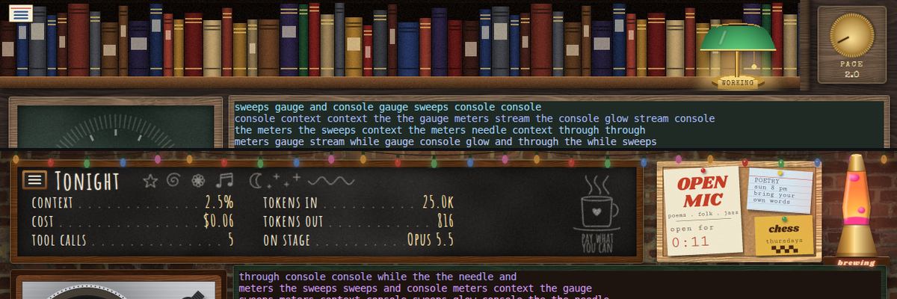

# Dev diary

One entry for each chapter of the history, written as the chapter was
merged, in plain words, with a picture.

| | Entry | Posted |
| --- | --- | --- |
|  | [Chapter 1: Drawing the map first](01-design.md) | Wednesday, October 14, 2026, at 4:07 PM |
|  | [Chapter 2: What to run, and what to call it](02-command-line.md) | Wednesday, October 14, 2026, at 4:29 PM |
|  | [Chapter 3: No data is not zero](03-meters.md) | Wednesday, October 14, 2026, at 4:49 PM |
|  | [Chapter 4: Reading Claude's clues](04-claude-logs.md) | Wednesday, October 14, 2026, at 5:08 PM |
|  | [Chapter 5: A skin is just data](05-skin-format.md) | Wednesday, October 14, 2026, at 5:28 PM |
|  | [Chapter 6: Two skins, deck and phosphor](06-deck-and-phosphor.md) | Wednesday, October 14, 2026, at 5:49 PM |
|  | [Chapter 7: A visualizer with no music](07-visualization.md) | Wednesday, October 14, 2026, at 6:07 PM |
|  | [Chapter 8: Who else is running?](08-finding-sessions.md) | Wednesday, October 14, 2026, at 6:30 PM |
|  | [Chapter 9: Plugging into Claude Code](09-claude.md) | Wednesday, October 14, 2026, at 6:50 PM |
|  | [Chapter 10: Codex, one log at a time](10-codex.md) | Wednesday, October 14, 2026, at 7:10 PM |
|  | [Chapter 11: One plug for every program](11-seam.md) | Wednesday, October 14, 2026, at 7:29 PM |
|  | [Chapter 12: One tab, start to finish](12-tabs.md) | Wednesday, October 14, 2026, at 7:51 PM |
|  | [Chapter 13: Seven small things, and a vanishing window](13-tab-features.md) | Wednesday, October 14, 2026, at 8:22 PM |
|  | [Chapter 14: The window, at last](14-window-and-install.md) | Wednesday, October 14, 2026, at 8:34 PM |
|  | [Chapter 15: A library and a coffee shop](15-library-and-coffee.md) | Wednesday, October 14, 2026, at 8:53 PM |
