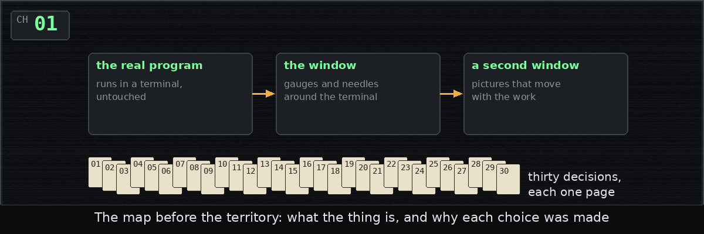
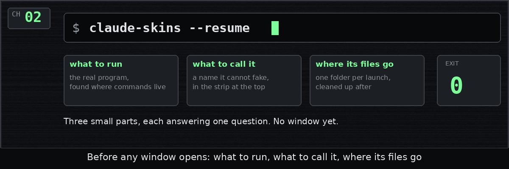
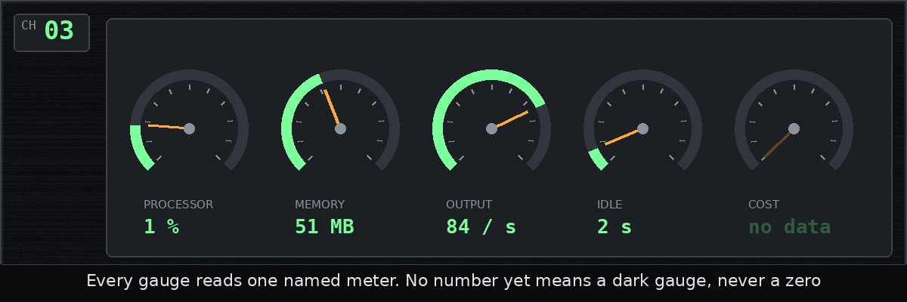
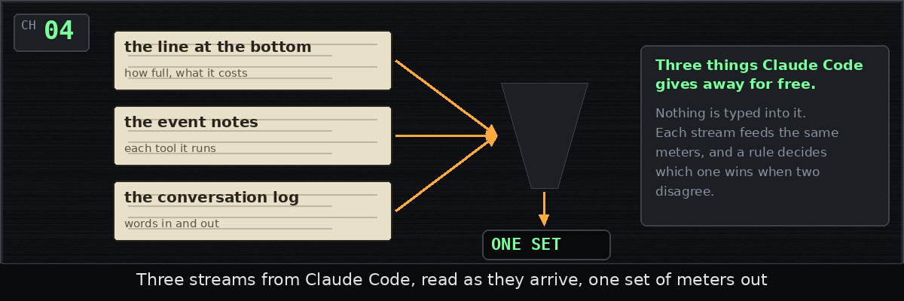

# Dev diary

One entry for each chapter of the history, written as the chapter was
merged, in plain words, with a picture.

| | Entry | Posted |
| --- | --- | --- |
|  | [Chapter 1: Drawing the map first](01-design.md) | Wednesday, October 14, 2026, at 4:07 PM |
|  | [Chapter 2: What to run, and what to call it](02-command-line.md) | Wednesday, October 14, 2026, at 4:29 PM |
|  | [Chapter 3: No data is not zero](03-meters.md) | Wednesday, October 14, 2026, at 4:49 PM |
|  | [Chapter 4: Reading Claude's clues](04-claude-logs.md) | Wednesday, October 14, 2026, at 5:08 PM |
