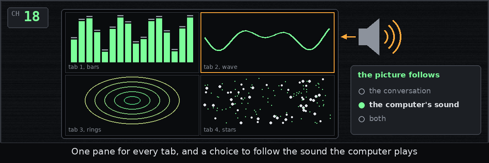
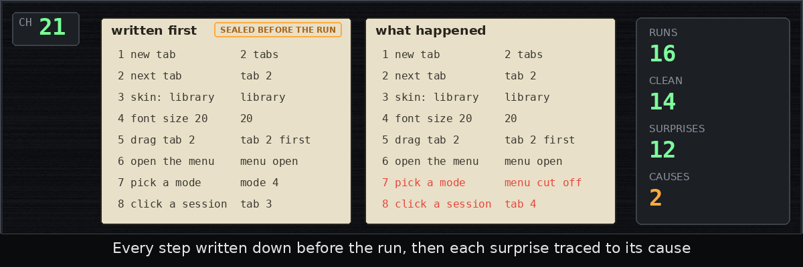
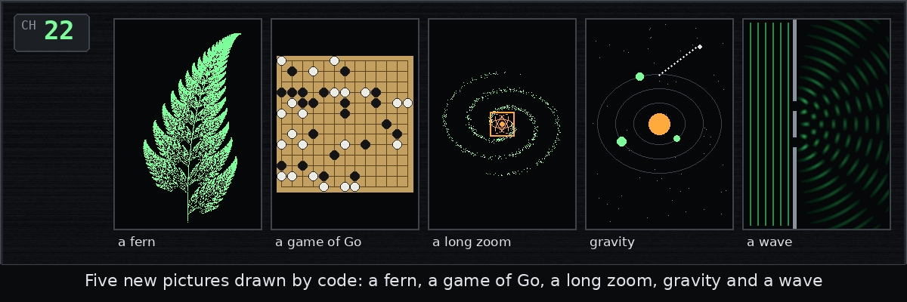

# The skindeep dev diary

skindeep puts Winamp-style skins around Claude Code and Codex on Linux:
the real terminal in the middle, live gauges and lamps around it, and a
visualizer in a second window. This site is the diary of building it,
one entry for each chapter of the history, written as the chapter was
merged, in plain words, with a picture. The code and the install steps
are on [GitHub](https://github.com/b-g-goodell/skindeep).

The latest entry:

[Chapter 23: Chalk, and a shorter front page](diary/23-chalk-and-readme.md)

## Every entry

| | Entry | Posted |
| --- | --- | --- |
|  | [Chapter 1: Drawing the map first](diary/01-design.md) | Wednesday, October 14, 2026, at 4:07 PM |
|  | [Chapter 2: What to run, and what to call it](diary/02-command-line.md) | Wednesday, October 14, 2026, at 4:29 PM |
|  | [Chapter 3: No data is not zero](diary/03-meters.md) | Wednesday, October 14, 2026, at 4:49 PM |
|  | [Chapter 4: Reading Claude's clues](diary/04-claude-logs.md) | Wednesday, October 14, 2026, at 5:08 PM |
|  | [Chapter 5: A skin is just data](diary/05-skin-format.md) | Wednesday, October 14, 2026, at 5:28 PM |
|  | [Chapter 6: Two skins, deck and phosphor](diary/06-deck-and-phosphor.md) | Wednesday, October 14, 2026, at 5:49 PM |
|  | [Chapter 7: A visualizer with no music](diary/07-visualization.md) | Wednesday, October 14, 2026, at 6:07 PM |
|  | [Chapter 8: Who else is running?](diary/08-finding-sessions.md) | Wednesday, October 14, 2026, at 6:30 PM |
|  | [Chapter 9: Plugging into Claude Code](diary/09-claude.md) | Wednesday, October 14, 2026, at 6:50 PM |
|  | [Chapter 10: Codex, one log at a time](diary/10-codex.md) | Wednesday, October 14, 2026, at 7:10 PM |
|  | [Chapter 11: One plug for every program](diary/11-seam.md) | Wednesday, October 14, 2026, at 7:29 PM |
|  | [Chapter 12: One tab, start to finish](diary/12-tabs.md) | Wednesday, October 14, 2026, at 7:51 PM |
|  | [Chapter 13: Seven small things, and a vanishing window](diary/13-tab-features.md) | Wednesday, October 14, 2026, at 8:22 PM |
|  | [Chapter 14: The window, at last](diary/14-window-and-install.md) | Wednesday, October 14, 2026, at 8:34 PM |
|  | [Chapter 15: A library and a coffee shop](diary/15-library-and-coffee.md) | Wednesday, October 14, 2026, at 8:53 PM |
|  | [Chapter 16: The front page](diary/16-readme.md) | Wednesday, October 14, 2026, at 9:11 PM |
|  | [Chapter 17: Every profile on the machine](diary/17-chooser-and-strip.md) | Wednesday, October 14, 2026, at 9:33 PM |
|  | [Chapter 18: One pane per tab, and the room's sound](diary/18-viz-panes-and-sound.md) | Wednesday, October 14, 2026, at 9:56 PM |
|  | [Chapter 19: Half a screen, a Settings menu and a tab popped out](diary/19-window-fit.md) | Wednesday, October 14, 2026, at 10:16 PM |
|  | [Chapter 20: When the limits reset](diary/20-usage-limits.md) | Wednesday, October 14, 2026, at 10:37 PM |
|  | [Chapter 21: Random clicks, written down first](diary/21-fuzz.md) | Wednesday, October 14, 2026, at 10:57 PM |
|  | [Chapter 22: Ferns, Go, gravity and a wave](diary/22-procedural-modes.md) | Wednesday, October 14, 2026, at 11:16 PM |
|  | [Chapter 23: Chalk, and a shorter front page](diary/23-chalk-and-readme.md) | Wednesday, October 14, 2026, at 11:42 PM |
